# Summary

The same small feature — check whether fictional room A204 is free for a start time and a
duration — was built twice from one contract: once as a static HTML/JavaScript page and once in
the Appsmith visual builder. Both pass the eight shared tests. The code-based version took about
4 minutes to build and has no open defects; the low-code version took about 11 minutes and has two
open defects (a stale result after editing an input, and a cramped phone layout). I recommend the
code-based version as the reference implementation; reasons are in section 8.

| | |
|---|---|
| Live demo, code-based | <https://merelymerey.github.io/smart-campus-p12/code-based/> |
| Live demo, low-code (Appsmith, published and public) | <https://app.appsmith.com/app/smart-campus-p12-low-code/page1-6b05614eb238dbe867c49a0e> |
| Public repository (source, export, report, screenshots, evidence) | <https://github.com/merelymerey/smart-campus-p12> |
| Low-code export | `low-code/appsmith-export.json` in the repository (Appsmith "Export application") |
| AI tool | Claude Code CLI 2.1.331 (Anthropic). Working session: model `claude-fable-5-2`. Three separate headless sessions (`claude -p`) for the two suggested prompts: model `claude-opus-5-5`. |
| Other tools | Appsmith Cloud free plan; Node 25.6.1, Vitest 5.1.1, ESLint 9; Playwright and the Claude in Chrome extension to drive the browsers; GitHub Pages |

**How the work was done (label).** The tools were operated by the AI agent under my supervision:
it wrote the code, dragged the widgets in my Chrome, typed the test inputs and read the results
back. I signed in to Appsmith myself and approved publishing and the export. Every result below
was observed in a real run on 24 November 2026; nothing is simulated. What is incomplete is marked
"unresolved" or "not tested".

# 1. Task 1 — Frozen baseline

| Item | Recorded value |
|---|---|
| Baseline | final project of Practice #11, git tag `final-p11`, commit `95d64e0`, package version 0.7.0, working tree clean |
| Rule engine | `validation.js`, SHA-256 `16c497cb…e95e35e` — **not modified** in this practice (checked with `git diff`) |
| Booking data | room A204, open, one booking 600–660 (10:00–11:00); room B101, blocked |
| Expected behaviour | whole minutes after midnight; start after the supplied current time; interval at most 120 min; blocked room and overlapping interval are unavailable; touching intervals are allowed; a check never saves anything |
| Existing checks | `npm test`: 116 passed (4 files); ESLint: exit code 0 |

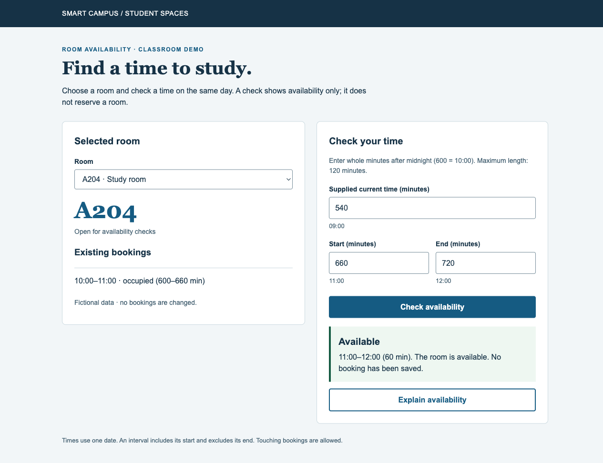{width=62%}

The baseline is tagged `baseline-p12` in the new repository. Evidence: `evidence/01-baseline-*.txt`.

# 2. Task 2 — Shared contract (one sheet for both solutions)

**User story.** As a student, I want to enter a future start time and a duration for the campus
study room and immediately see whether the room is Available or Unavailable and why, so that I can
pick a time that works — without creating, changing or deleting any booking.

| ID | Acceptance criterion |
|----|-----------|
| AC1 | Start time must be in the future (strictly after the supplied current time). |
| AC2 | Duration must be greater than zero and at most 120 minutes. |
| AC3 | An interval that overlaps an existing booking is unavailable. |
| AC4 | A blocked room is unavailable. |
| AC5 | A clear decision is displayed and the existing bookings are not changed. |
| AC6 | Invalid input receives understandable feedback. |

**Inputs:** `now` (supplied current time, 0–1439), `start` (0–1439), `duration` (minutes),
`blocked` (true/false), `bookings` = `[[600, 660]]` (fictional, read-only).
**Outputs:** `available` (boolean), `reasonCode` (string), `message` (visible sentence); the screen
also shows a one-word decision.

| # | Condition (checked in this order) | reasonCode | Decision | Visible message |
|---|---|---|---|---|
| 1 | a value is empty / not a whole number, or `now`/`start` outside 0–1439 | `INVALID_INPUT` | Invalid input | Enter whole minutes. Current time and start must be between 0 and 1439. |
| 2 | `duration <= 0` | `INVALID_DURATION` | Invalid input | Duration must be greater than zero. |
| 3 | `start + duration > 1440` | `OUT_OF_DAY` | Invalid input | The interval must end by 24:00 on the same day. |
| 4 | `start <= now` | `PAST_TIME` | Invalid input | Start must be after the supplied current time. |
| 5 | `duration > 120` | `TOO_LONG` | Invalid input | Choose a duration of 120 minutes or less. |
| 6 | room is blocked | `ROOM_BLOCKED` | Unavailable | This room is blocked and cannot be used. |
| 7 | overlaps a booking (`start < e` and `s < start + duration`) | `OVERLAP` | Unavailable | This interval overlaps an existing booking. |
| 8 | otherwise | `AVAILABLE` | Available | The room is available. No booking has been saved. |

The contract and the test inputs (`contract/CONTRACT.md`, `contract/test-cases.json`) were
committed (tag `contract-p12`) **before** either implementation was started.

# 3. Task 3 — Code-based solution

Built by one headless AI session from the slide's implementation prompt (exact prompt:
`evidence/03-code-ai/prompt-1.txt`; unedited answer: `response-1.md`; unedited code: git tag
`code-ai-v1`).

| Layer | File | Role |
|---|---|---|
| Rule engine (frozen) | `validation.js` | the Practice #06 rules, unchanged |
| Input validation + availability | `contract.js` | `checkAvailability({now, start, duration, blocked, bookings})` → `{available, reasonCode, message}`; no DOM; delegates the decision to the frozen engine; throws instead of guessing if the engine returns something unknown |
| Data | `data.js` | room A204, bookings `[[600, 660]]`, deeply frozen |
| UI display | `app.js`, `format.js`, `index.html`, `style.css` | reads the inputs, writes decision / reason code / message with `textContent` |

Code evidence (the whole decision path of `contract.js`):

```js
export function checkAvailability({ now, start, duration, blocked, bookings }) {
  if (typeof blocked !== 'boolean') throw new TypeError('blocked must be a boolean');
  if (!Array.isArray(bookings)) throw new TypeError('bookings must be an array of [start, end] pairs');
  // Layer 1 — input validation (contract rules 1 and 2).
  if (![now, start, duration].every(Number.isInteger) || !inDay(now) || !inDay(start)) return result('INVALID_INPUT');
  if (duration <= 0) return result('INVALID_DURATION');
  // Layer 2 — availability calculation, delegated to the frozen rule engine (rules 3–8).
  const engine = validateAvailability(start, start + duration, now, blocked, bookings);
  const reasonCode = ENGINE_REASONS[engine.message];
  if (!reasonCode || engine.available !== (reasonCode === 'AVAILABLE')) {
    throw new Error(`Unexpected rule engine result: ${JSON.stringify(engine)}`);
  }
  return result(reasonCode);
}
```

Checks: `npm test` → 94 passed (23 frozen baseline tests + 71 contract tests); ESLint exit 0.

<div style="text-align:center;page-break-inside:avoid"><figure style="display:inline-block;vertical-align:top;margin:6px">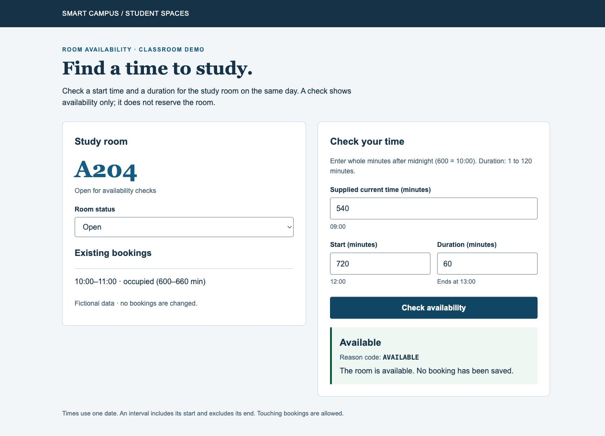<figcaption>Code-based, 1280 px, T1 → Available.</figcaption></figure><figure style="display:inline-block;vertical-align:top;margin:6px">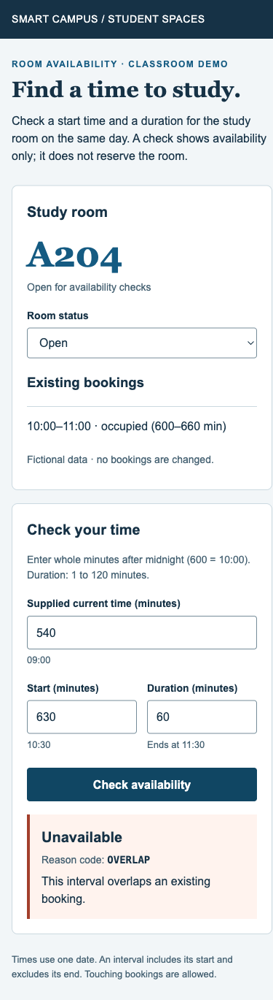<figcaption>Code-based, 390 px, T2 → Unavailable (no horizontal scroll).</figcaption></figure></div>

**Changes against the baseline UI** (the rules did not change): End time replaced by Duration; one
room with an Open/Blocked status control instead of a two-room list; reason code shown; the
Practice #11 "Explain availability" feature and its server were removed because the slide says it
is not required and the page must work as a static site.

# 4. Task 4 — Low-code solution (Appsmith Cloud, free plan)

New application "Smart Campus P12 Low-code", built in the visual editor.

| Part | How it was made | Script needed? |
|---|---|---|
| 10 widgets: 4 Text, 3 Input, 1 Radio Group, 1 Button, 1 Table | dragged from the widget panel onto the canvas | no |
| Names, labels, default values (540 / 720 / 60), radio options Open / Blocked | property pane | no |
| Button → run the check | one expression in `onClick`: `{{ storeValue('result', Rules.evaluate(NowInput.text, StartInput.text, DurationInput.text, StatusRadio.selectedOptionValue === 'Blocked'), false) }}` | one line |
| Decision, reason code, message, bookings table | one `{{ }}` binding each, e.g. `{{ Rules.bookingRows() }}` | one line each |
| Bookings and the eight rules | one JS object `Rules` (122 lines, `low-code/Rules.js`) | **yes** |

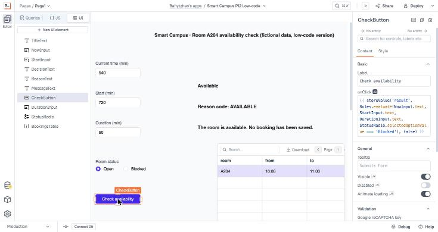{width=78%}

{width=78%}

**Requirements the platform could not implement, or not without code**

* The rules themselves. Appsmith has no visual way to express "overlaps a booking" or an ordered
  list of eight checks; they are plain JavaScript inside the platform. So the "low-code" version
  still contains 122 lines of code — only the screen is visual.
* Read-only bookings (AC5) are followed but not enforced: the list is an ordinary editable variable
  inside `Rules`; the code-based version freezes it.
* A layout that re-flows on a phone (see D3 below).
* Automated tests in a pipeline: the only test hook is a `selfTest` function run by hand in the editor.

**AI answer and what I changed.** The AI proposed the widgets, the bindings and `Rules`
(`evidence/04-lowcode-ai/`, unedited script in `low-code/Rules.ai-v1.js`). I changed one function,
`toWhole`, so that text is parsed exactly like the code-based version. I used "Reason code: …"
and "Ready to check" wording to match the code-based page, and left out the proposed extra
"raw bookings" text and clear-on-change handlers (the second omission is defect D2).

# 5. Task 5 — Identical tests

`now = 540` (09:00) in every case. "Observed" is what the screen showed.

| ID | Input (start, duration, status) | Expected | Observed, code-based | Observed, low-code |
|---|---|---|---|---|
| T1 | 720, 60, open | Available · `AVAILABLE` | Available · `AVAILABLE` ✔ | Available · `AVAILABLE` ✔ |
| T2 | 630, 60, open | Unavailable · `OVERLAP` | Unavailable · `OVERLAP` ✔ | Unavailable · `OVERLAP` ✔ |
| T3 | 720, 60, blocked | Unavailable · `ROOM_BLOCKED` | Unavailable · `ROOM_BLOCKED` ✔ | Unavailable · `ROOM_BLOCKED` ✔ |
| T4 | 720, 0, open | validation error · `INVALID_DURATION` | Invalid input · `INVALID_DURATION` ✔ | Invalid input · `INVALID_DURATION` ✔ |
| T5 | 720, 121, open | validation error · `TOO_LONG` | Invalid input · `TOO_LONG` ✔ | Invalid input · `TOO_LONG` ✔ |
| T6 | 500, 60, open | validation error · `PAST_TIME` | Invalid input · `PAST_TIME` ✔ | Invalid input · `PAST_TIME` ✔ |
| T7a | 660, 60, open (starts when the booking ends) | Available · `AVAILABLE` | Available · `AVAILABLE` ✔ | Available · `AVAILABLE` ✔ |
| T7b | 570, 30, open (ends when the booking starts) | Available · `AVAILABLE` | Available · `AVAILABLE` ✔ | Available · `AVAILABLE` ✔ |
| T8 | after T1–T7 | bookings still exactly 10:00–11:00 | list before = list after: "10:00–11:00 · occupied (600–660 min)" ✔ | table still "1 Records · A204 10:00 11:00 600 660" ✔ |
| **Total** | | | **8 / 8** | **8 / 8** (after repairing D1) |

The visible message matched the contract text in every case in both versions. T7 counts as one
test (both rows must pass). Code-based: run through the real page at 1280 px and at 390 px with the
same results. Low-code: run on the deployed app in View mode at 1470 px.
Raw results: `evidence/05-tests/*.json`.

<table class="shots"><tr><th></th><th>Code-based (local page, 1280 px)</th><th>Low-code (deployed Appsmith app)</th></tr><tr><th style="width:34px;text-align:center;vertical-align:middle">T1</th><td style="text-align:center;vertical-align:middle"></td><td style="text-align:center;vertical-align:middle"></td></tr><tr><th style="width:34px;text-align:center;vertical-align:middle">T2</th><td style="text-align:center;vertical-align:middle"></td><td style="text-align:center;vertical-align:middle"></td></tr><tr><th style="width:34px;text-align:center;vertical-align:middle">T3</th><td style="text-align:center;vertical-align:middle"></td><td style="text-align:center;vertical-align:middle">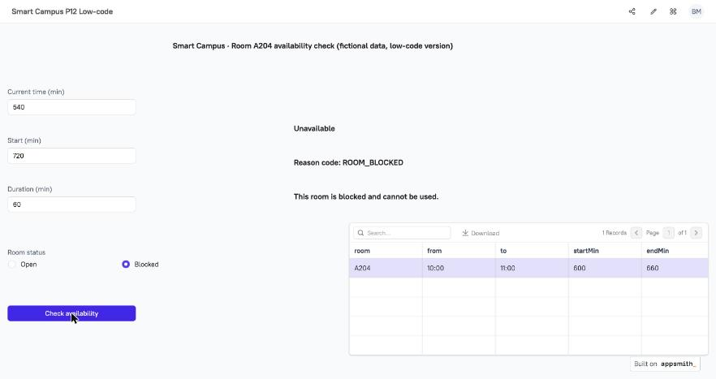</td></tr><tr><th style="width:34px;text-align:center;vertical-align:middle">T4</th><td style="text-align:center;vertical-align:middle"></td><td style="text-align:center;vertical-align:middle"></td></tr><tr><th style="width:34px;text-align:center;vertical-align:middle">T5</th><td style="text-align:center;vertical-align:middle"></td><td style="text-align:center;vertical-align:middle">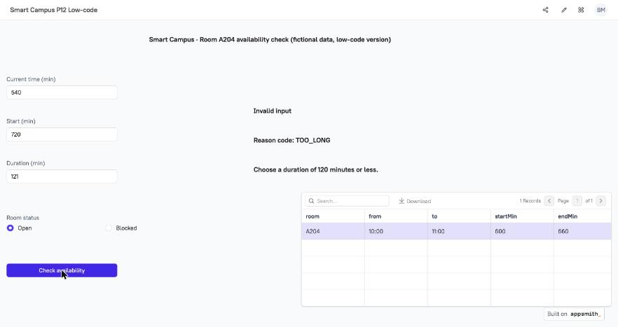</td></tr><tr><th style="width:34px;text-align:center;vertical-align:middle">T6</th><td style="text-align:center;vertical-align:middle">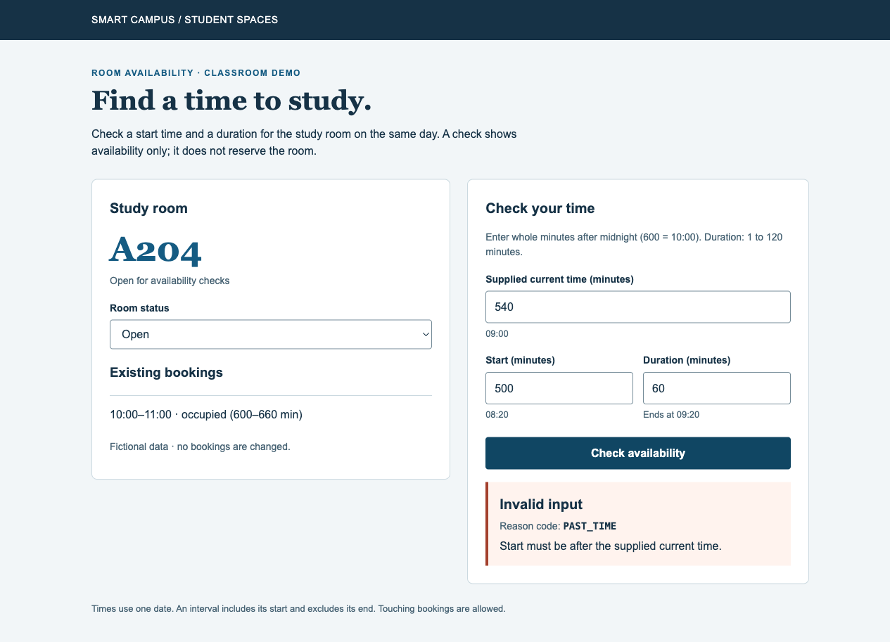</td><td style="text-align:center;vertical-align:middle"></td></tr><tr><th style="width:34px;text-align:center;vertical-align:middle">T7a</th><td style="text-align:center;vertical-align:middle"></td><td style="text-align:center;vertical-align:middle">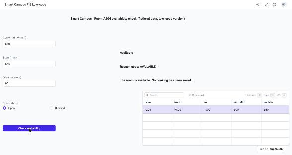</td></tr><tr><th style="width:34px;text-align:center;vertical-align:middle">T7b</th><td style="text-align:center;vertical-align:middle"></td><td style="text-align:center;vertical-align:middle">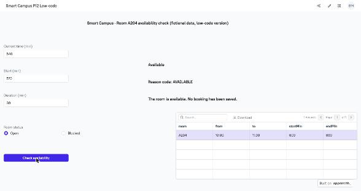</td></tr></table>

T8 is visible in every screenshot: the bookings list / table still shows only A204 10:00–11:00.

# 6. Task 6 — Engineering effort

## Measured results

Times come from a time log written with `date` at each step, the seconds reported by the AI
sessions and the screenshot file times (`evidence/06-effort-and-defects.md`).
They are minutes with an AI agent operating the tools, measured once.

| Phase | Code-based | Low-code |
|---|---|---|
| Setup | 0.3 min (`npm install`) | included below (creating the app took under a minute; not stamped separately) |
| Implementation | 3.5 min (AI session 199 s incl. 71 unit tests + review/commit) | 9.9 min (AI design answer 2.0 min + 7.9 min in the editor up to the first deploy) |
| Debugging / repair | 0 min functional; 0.4 min dependency upgrade | about 1 min (defect D1) |
| Testing T1–T8 | 0.4 min, automated script, two widths | about 2 min, typed case by case, one width |
| **Build + repair** | **4.2 min** | **about 10.9 min** |
| Acceptance tests passed | 8 / 8 | 8 / 8 |
| Unresolved defects | 0 | 2 (D2, D3) |

Not counted: 1.3 min shared work (baseline + contract), 5.5 min waiting for my Appsmith sign-in,
about 3 min lost when the browser extension reconnected.

| ID | Defect observed | Status |
|---|---|---|
| D1 (low-code) | After the first deploy the Start and Duration fields were empty although 720 and 60 had been entered. Two properties of one widget were saved at the same instant and one save overwrote the other. | Repaired, redeployed |
| D2 (low-code) | The old decision stays on screen after an input is edited until Check is pressed again; the code-based page clears it. | Unresolved |
| D3 (low-code) | At 390 px the canvas only shrinks: labels cut ("Curren…"), button reads "Che…", table cropped. | Unresolved |
| S1 (code-based) | `npm audit`: 3 advisories (2 critical) in the test tooling. | Repaired: Vitest 3.2.7 → 5.1.1, audit 0 |
| Q1 (both) | `1e2` typed as duration is accepted as 100. | Documented, left |

<div style="text-align:center;page-break-inside:avoid"><figure style="display:inline-block;vertical-align:top;margin:6px">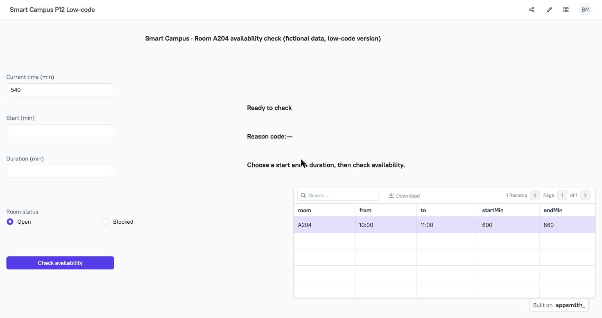<figcaption>D1: Start and Duration empty after the first deploy.</figcaption></figure><figure style="display:inline-block;vertical-align:top;margin:6px">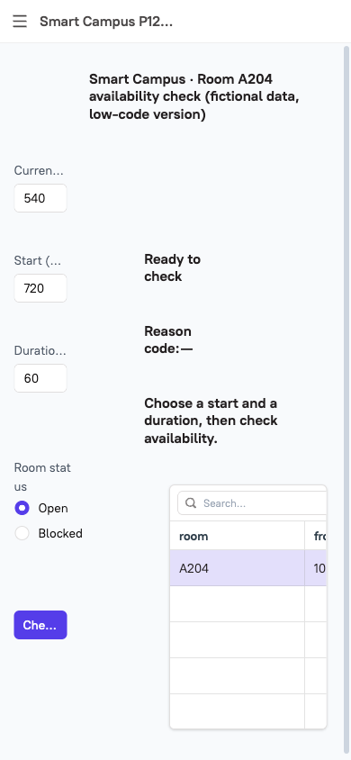<figcaption>D3: published low-code app at 390 px.</figcaption></figure></div>

## How changes are reviewed, exported and version-controlled (observed)

| | Code-based | Low-code |
|---|---|---|
| Review | text diff per commit; the AI's first version is tag `code-ai-v1`, the final is `code-final` | no diff view used; I compared the saved state by reloading the editor. The editor offers "Connect Git" (not set up, not tested) |
| Export | the repository itself; runs anywhere a static file server runs | "Export application" → one 73 KB JSON (schema: client 2.0, server 13.0); it can only be opened by Appsmith |
| Version control | git history with tags for each stage, public on GitHub | the deployed version is whatever was last deployed; history is the exported JSON I committed to git by hand |

## Personal impressions (not measured)

* The low-code screen felt faster to *see* (widgets appear at once) but slower to *get right*:
  most of the editor time went into placing and re-placing widgets.
* A person dragging widgets by hand would probably not hit the automation problems I had, so the
  low-code number is likely pessimistic for a human; the code-based number is likely optimistic,
  because the AI wrote the code much faster than I could.
* I trusted the code-based result more because 94 tests re-run in a second; in Appsmith I had to
  click through each case again after the repair.

# 7. Task 7 — Security review (Lecture #12)

Only my own page and my own Appsmith app were checked, by hand, with harmless inputs. No scanner
was run against Appsmith or GitHub.

| Check | Code-based | Low-code (Appsmith) |
|---|---|---|
| Injection / XSS: input handling | Inputs go through `Number()` and whole-number checks; nothing typed is echoed back. Source search: no `innerHTML`, `eval`, `document.write`, `fetch`, or storage use. | Inputs are passed as text to `Rules.toWhole`; nothing typed is echoed back. |
| Injection / XSS: output handling | All output written with `textContent`; messages are fixed strings. | Text widgets show fixed strings from `Rules`. Typing `` into Start gave "Invalid input · INVALID_INPUT" and the page title did not change (screenshot below). This tests my app only, not Appsmith's widgets in general. |
| SQL injection | Not applicable: no database, no server code. | Not applicable in this app: export shows 0 datasources. It becomes relevant the moment a datasource is connected. |
| Permissions / authentication | No login by design; anyone can open the static page; nobody can change it without push access to the repository. | New apps are private: before I shared it, the app URL redirected a signed-out browser to the login page. The editor URL still redirects to login after publishing (checked signed-out). On the free plan an invited user gets access to **all** apps in the workspace; app-level access is offered only on a paid plan (stated in the Share dialog). |
| Public sharing | Public on purpose (GitHub Pages). | "Make application public" was off by default; I turned it on for the demo. The signed-out check showed the app working and a Sign-in button, nothing else. |
| Sensitive data exposure | Only fictional data. HTTPS with HSTS header from GitHub Pages; **no Content-Security-Policy header** (GitHub Pages does not let me set one). | Only fictional data. **Finding:** a new Text widget is pre-filled with a greeting bound to `appsmith.user.name` (falling back to `appsmith.user.email`) — the default would have shown the signed-in user's name or e-mail in a public app. I replaced all four texts; the export contains no name or e-mail (searched). The Table widget ships with Search and Download switched on; harmless here, a leak path with real data. |
| Secrets | None exist. No API key, no `.env`; checked the repository for key-like strings before pushing. | None exist: no datasource, no API action. Note for later: in Appsmith a secret must live in a datasource on the server side, never in a JS object or widget, because those are sent to the browser. |
| Connector access | None. | None connected. Sign-in used a third-party identity provider (my choice at sign-up). |
| Dependencies / platform updates (SCA view) | **My job.** `npm audit` found 3 advisories in dev tooling; fixed by upgrading (evidence `07-npm-audit-*.txt`). The page itself ships zero third-party code. Version ranges use `^`, so the audit must be repeated. | **Mostly the vendor's job, and invisible to me.** I cannot run an audit of Appsmith's libraries, cannot pin the platform version, and it can change under my app without a commit. Third-party script observed: a Google reCAPTCHA badge loaded in the editor. My job: the 122 lines in `Rules`, sharing settings, who is in the workspace. |
| Safe runtime checks (DAST view) | Empty start, `-5`, `2000`, `60.5` → Invalid input; `1400`+60 → OUT_OF_DAY; `1e2` → accepted as 100 (Q1). | HTML string → Invalid input; `60.5` → Invalid input; `1e2` → accepted as 100 (Q1); edited input without pressing Check → old result stays (D2). |
| Least privilege for the AI agent | The implementation session could only edit files and run `npm`/`node`/`rm`/`ls`; the review session was read-only (Read, Glob, Grep). | The agent worked in my signed-in browser; I did the sign-in, and approved publishing and the export download separately. |

<div style="text-align:center;page-break-inside:avoid"><figure style="display:inline-block;vertical-align:top;margin:6px">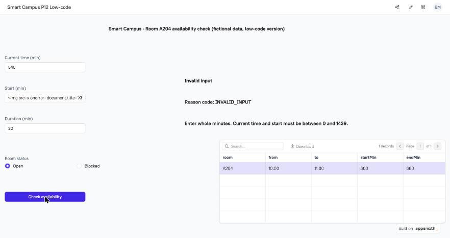<figcaption>Low-code: HTML typed into Start is treated as invalid input.</figcaption></figure><figure style="display:inline-block;vertical-align:top;margin:6px">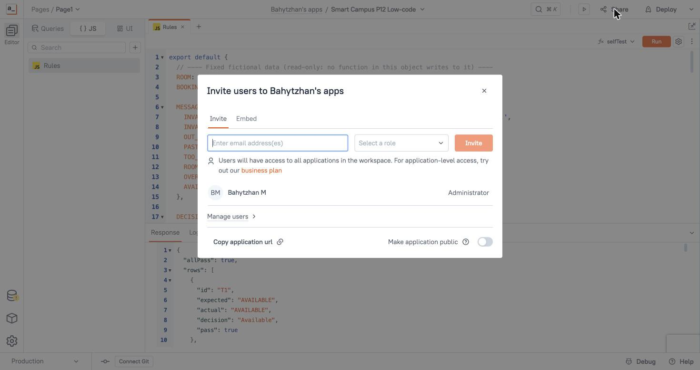<figcaption>Appsmith Share dialog: "Make application public" is off by default.</figcaption></figure></div>

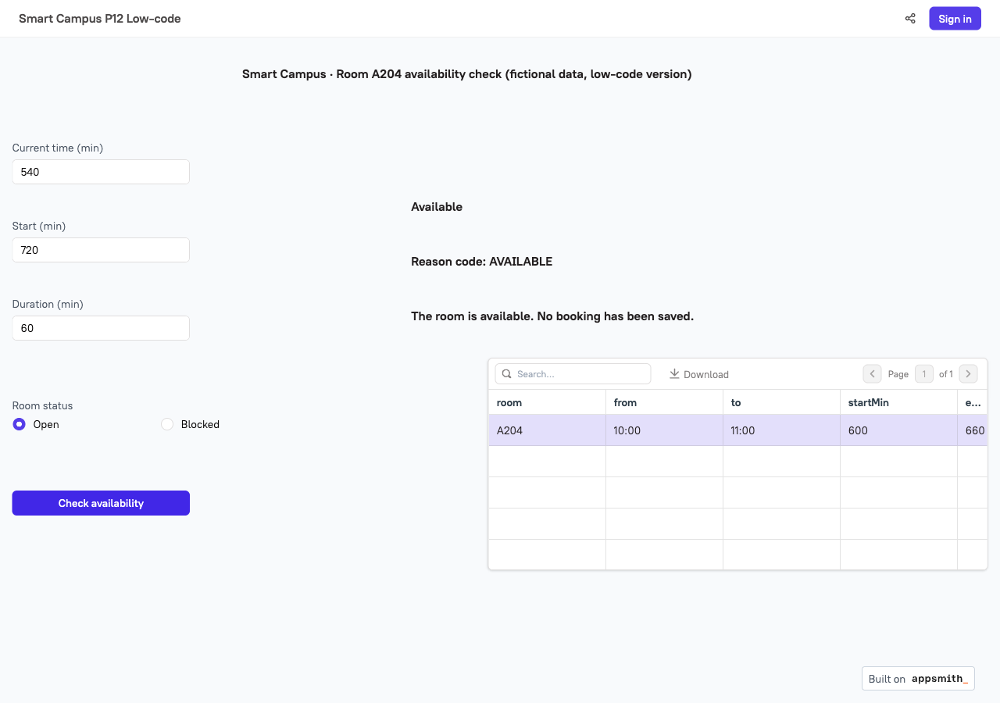{width=62%}

**Security checklist**

| # | Item | Code | Low-code |
|---|---|---|---|
| 1 | Only fictional data, no personal data shown | ✔ | ✔ (after removing the default user greeting) |
| 2 | User input validated before use | ✔ | ✔ |
| 3 | Output cannot inject HTML/script (tested with a harmless string) | ✔ | ✔ (own app only) |
| 4 | No secrets in client code, repository, export or screenshots | ✔ | ✔ |
| 5 | Sharing is deliberate and minimal | ✔ public by design | ✔ public view only; editor needs login. ✘ free plan cannot limit a collaborator to one app |
| 6 | Dependencies checked and updated | ✔ audit 3 → 0 | ✘ not possible for me on the hosted platform |
| 7 | Bookings cannot be changed | ✔ frozen data + tests | ◐ unchanged in tests, but not enforced |
| 8 | Result always matches the inputs on screen | ✔ | ✘ D2 |
| 9 | Transport security | ✔ HTTPS + HSTS; ✘ no CSP header | ✔ HTTPS (headers not examined) |
| 10 | AI changes verified with reproducible evidence | ✔ tests, tags, logs | ✔ screenshots, export, results file |

# 8. Comparison matrix and recommendation

| Criterion | Code-based | Low-code |
|---|---|---|
| Functional tests | **8 / 8** | **8 / 8** (after one repair) |
| Build and repair time | **4.2 min** | **about 10.9 min** |
| Customization | Full control of markup, layout and behaviour; works at 390 px; result resets on edit. | Fast standard widgets, but phone layout cannot re-flow on the classic canvas (D3) and every behaviour beyond the widget defaults needs an expression or script (D2 would need four more handlers). |
| Security controls | I control everything and am responsible for everything: validation, `textContent`, frozen data, dependency audit. No CSP on GitHub Pages. | Good defaults for access (private until shared, editor behind login). Risky defaults for data (user greeting, table download). Platform libraries cannot be audited or pinned by me. |
| Versioning / portability | Plain files in git with diffs and tags; runs on any static host. | One JSON export readable only by Appsmith; only `Rules.js` could be reused elsewhere. Git sync exists in the editor but was not tested. |
| Ongoing cost | 0 for hosting on GitHub Pages; my time for dependency updates (0.4 min once, must be repeated). | 0 on the free plan used here. Per-app access control is on a paid plan according to the Share dialog; I did not check prices and did not buy anything. Vendor updates cost me nothing but can change behaviour. |

**Recommendation.** For this checker I would keep the code-based version. On the evidence it was
quicker to build, has no open defects, works on a phone, can be re-tested automatically in a second
and is ordinary files under version control. The low-code version reached the same 8 / 8, but the
part that matters — the rules — was still code, just code stored inside a platform where I cannot
diff, unit-test in a pipeline or audit the libraries. Low-code would become the better choice if
the task were mostly screens over an existing database for staff users (tables, forms, logins),
because that is what the widgets and the built-in access control are good at. Neither version is
production-ready: both trust a current time typed by the user and hard-coded bookings; a real
service needs the rule check on a server with the server clock.

# 9. AI-use reflection

| Session | Prompt | What it gave | What I checked or changed |
|---|---|---|---|
| Implementation (code) | slide's implementation prompt + my constraints (`evidence/03-code-ai/prompt-1.txt`) | all code-based files and 71 tests; it stated it had **not** opened the page in a browser | I re-ran tests and lint myself, ran T1–T8 in a browser at two widths, confirmed `validation.js` was untouched. Accepted without code changes; later upgraded Vitest. |
| Implementation (Appsmith) | same prompt with `[environment]` = Appsmith (`evidence/04-lowcode-ai/prompt-2.txt`) | widget list, bindings, `Rules` script, manual test script; it marked editor details as "verify" because it could not run Appsmith | Changed `toWhole` to match the code version; all "verify" items held in the editor (`storeValue`, calling a JS object function in a binding, property names). |
| Comparison and review | slide's review prompt (`evidence/08-review-ai/prompt-3.txt`), read-only | found two real differences I had missed: the low-code blocked check fails open if the option value is ever renamed (`blocked === true`), and `Rules` returns nothing for an unknown code where the code version throws | Both are true (I read the lines) and are now listed as risks. Two of its "no evidence" notes were out of date: the self-test output and the HTTP headers are in this report. |

* **Useful:** speed, and the reviewer's fail-open finding.
* **Had to be corrected or caught by testing:** defect D1 was created by the agent's own automation
  and found only because the deployed app was tested, not the editor preview. The first drags
  created a wrong widget.
* **Honesty rule kept:** each AI answer says what it did not verify; the numbers in this report are
  from runs I can show (logs, screenshots, results files), not from the AI's claims.
* **Not proved:** equivalence beyond these eight cases and a few probes; accessibility; behaviour
  with real data or several users; human build times.

# 10. Change log and files

| Tag / commit | Content |
|---|---|
| `baseline-p12` | frozen Practice #11 final + baseline evidence |
| `contract-p12` | shared contract and test inputs |
| `code-ai-v1` | code-based version exactly as the AI wrote it |
| `code-final` | browser test evidence; Vitest 3.2.7 → 5.1.1 |
| later commits | AI answer for Appsmith, `Rules.js`, Appsmith export, screenshots, results, this report |

Folders: `contract/`, `code-based/`, `low-code/` (`Rules.ai-v1.js`, `Rules.js`,
`appsmith-export.json`), `evidence/`, `screenshots/`, `report/`.
